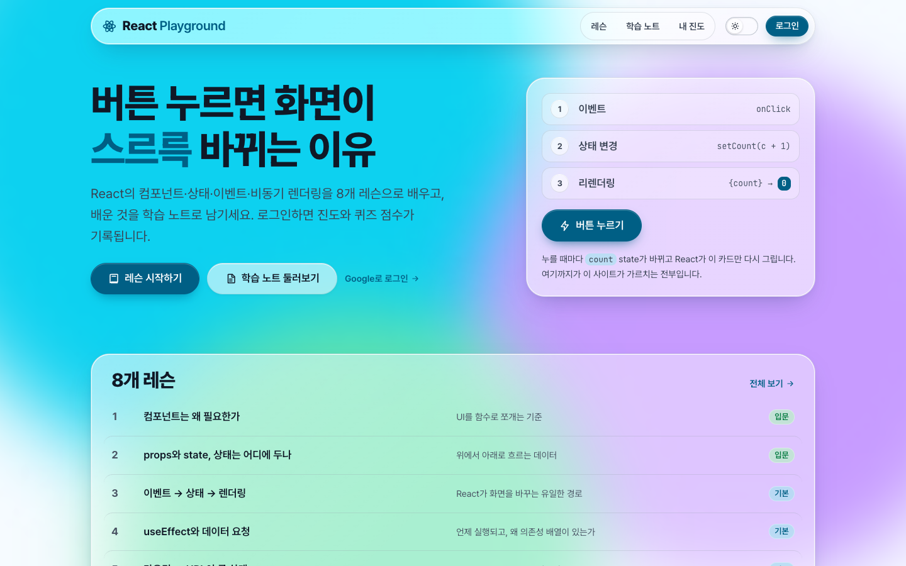
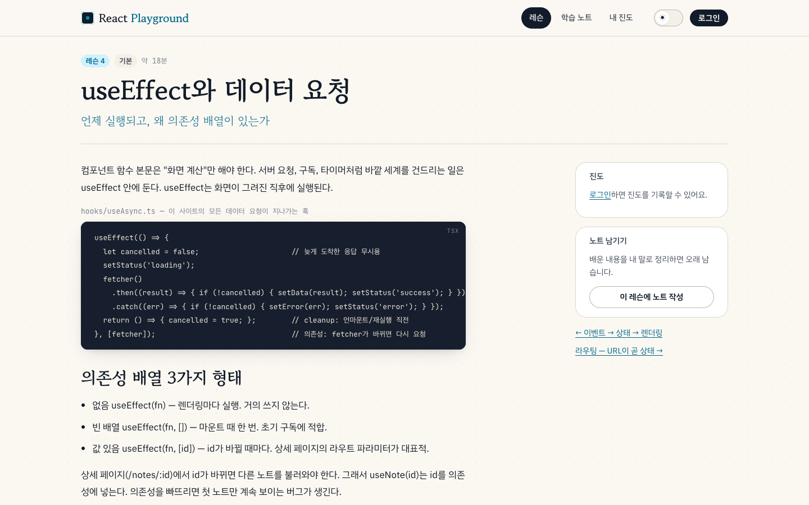
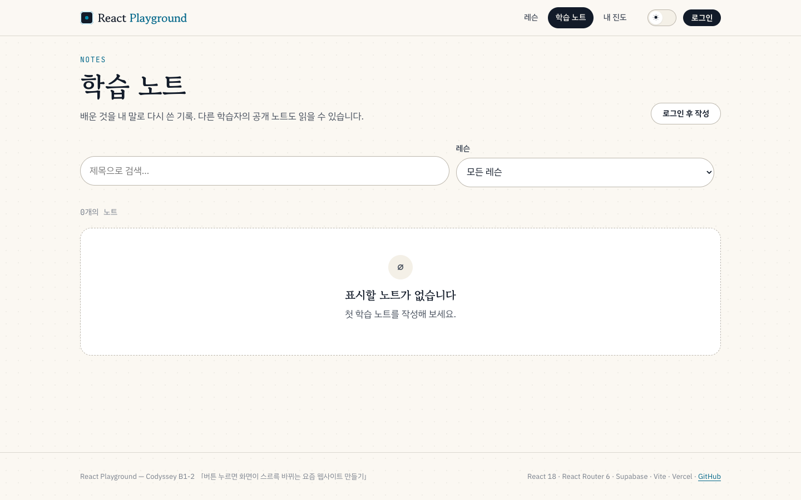
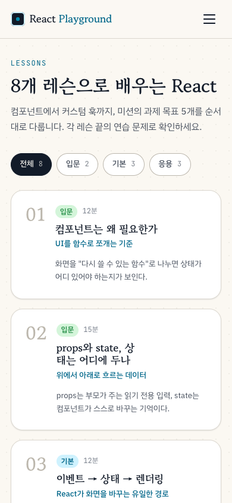
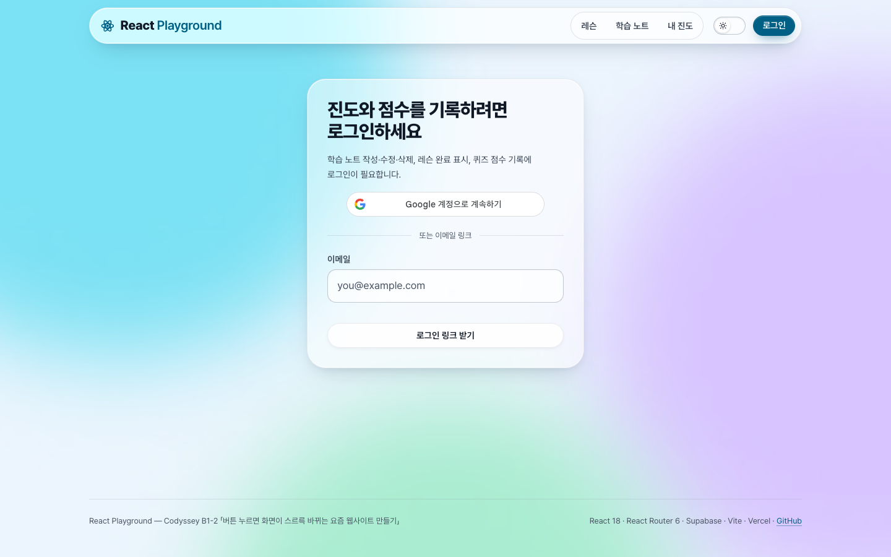

# React Playground — 버튼 누르면 화면이 스르륵 바뀌는 React 학습 사이트

React 18 + React Router 6 + Supabase로 만든 **React 학습용 SPA**입니다. 8개 레슨(컴포넌트 → props/state → 이벤트·렌더링 → useEffect → 라우팅 → 폼 → 로딩/에러/빈 상태 → 커스텀 훅)을 읽고, 레슨마다 연습 문제를 풀고, 배운 것을 **학습 노트**로 남깁니다. 로그인하면 **진도**와 **퀴즈 점수**가 기록됩니다. (Codyssey B1-2 미션)

- **배포 URL**: https://codyssey-b1-2-react.vercel.app
- **저장소**: https://github.com/newids/codyssey-b1-2
- **디자인 캔버스(Claude Design)**: https://claude.ai/artifact/9aihqFBtrWy3mQXXe1zvNU — 글래스모피즘 디자인 시스템(색·유리 재질·타이포·컨트롤)과 홈/레슨/모바일 목업
- **문서**: [미션 수행 가이드](docs/GUIDE.md) · [평가 설명서](docs/EVALUATION.md) · [평가 항목 답변 (빠른 버전)](docs/EVALUATION-QUICK.md) · [설정 가이드 (Supabase · Google 로그인 · Vercel)](docs/SETUP.md) · [배포 환경 CRUD 검증 기록](docs/DEPLOY-VERIFICATION.md)

## 문서

| 문서 | 내용 | 대상 |
| --- | --- | --- |
| [미션 수행 가이드](docs/GUIDE.md) | 미션 요구사항을 어떤 순서로, 어떤 판단으로 구현했는지. 이 저장소 코드를 기준으로 한 단계별 가이드 | 학습자 |
| [평가 설명서](docs/EVALUATION.md) | 요구사항 ↔ 구현 매핑(파일·행), 과제 목표 5개 상세 답변, "이벤트 → 상태 → 렌더링" 증빙 지점, 수동 QA 시나리오 | 평가자 · 구술 평가 준비 |
| [평가 항목 답변 (빠른 버전)](docs/EVALUATION-QUICK.md) | 같은 내용을 문항당 30초~2분 답변으로 줄인 버전 | 구술 답변 연습 |
| [설정 가이드](docs/SETUP.md) | 로컬 실행, Supabase 스키마·RLS, 환경변수, Google OAuth 설정, Vercel 배포 | 재현·운영 |
| [배포 환경 CRUD 검증 기록](docs/DEPLOY-VERIFICATION.md) | 배포 URL에서 등록 → 수정 → 삭제를 실제 수행한 화면 7장, Supabase REST 요청 로그(메서드·상태 코드·시각), 서버 측 조회 결과 | 평가자 |

## 스크린샷

| 홈 (데스크톱) | 레슨 상세 |
| --- | --- |
|  |  |

| 학습 노트 목록 — 빈 상태 | 레슨 목록 (모바일) |
| --- | --- |
|  |  |

| 로그인 — Google Identity Services 버튼 + 이메일 링크 |
| --- |
|  |

> 2026-09-23 글래스모피즘 리디자인 빌드 기준 캡쳐 (홈은 로컬 빌드, 나머지는 배포 URL).

## 배포 환경에서 CRUD 동작 확인 (2026-10-17)

배포 URL에서 로그인한 뒤 노트를 **등록 → 수정 → 삭제**하고, 화면·브라우저 요청 로그·서버 조회로 교차 확인했습니다. 전체 기록(화면 7장, 요청 로그, `curl` 응답)은 [docs/DEPLOY-VERIFICATION.md](docs/DEPLOY-VERIFICATION.md)에 있습니다.

| 등록 — 상세로 이동 + Toast | 수정 — "(수정됨)" 표시 | 삭제 — 목록 빈 상태 + Toast |
| --- | --- | --- |
|  |  |  |

```
POST   /rest/v1/notes -> 201   (등록, 서버 created_at 06:51:21Z)
PATCH  /rest/v1/notes -> 200   (수정) → 79ms 뒤 GET 200 (상세 재조회)
DELETE /rest/v1/notes -> 204   (삭제) → 65ms 뒤 GET 200 (목록 재조회)
```

**변경 후 상태 갱신 전략.** 노트 CRUD는 성공 뒤 `navigate()`로 경로를 바꾸고, 바뀐 라우트의 `useNote` / `useNotes`가 **다시 조회(refetch)** 합니다. 서버를 단일 진실로 두므로 롤백 로직이 없습니다. 레슨 완료 토글(`useLessonProgress`)만 **낙관적 업데이트**(즉시 반영, 실패 시 롤백)입니다. 즉시 반응이 중요하고 실패 비용이 낮은 곳에만 씁니다.

## 실행 방법

```bash
git clone https://github.com/newids/codyssey-b1-2.git
cd codyssey-b1-2
pnpm install          # 또는 npm install
cp .env.example .env  # VITE_SUPABASE_URL, VITE_SUPABASE_ANON_KEY, VITE_GOOGLE_CLIENT_ID 입력
pnpm dev              # http://localhost:5173
```

| 명령 | 설명 |
| --- | --- |
| `pnpm dev` | 개발 서버 |
| `pnpm build` | 타입 검사 + 프로덕션 빌드 (`dist/`) |
| `pnpm preview` | 빌드 결과 미리보기 |
| `pnpm test` | Vitest 테스트 (13개 파일, 61개) |
| `pnpm test:coverage` | 커버리지 리포트 |

Supabase 프로젝트 생성·스키마·Google 로그인·Vercel 배포 절차는 [docs/SETUP.md](docs/SETUP.md)에 있습니다.

## 사용 기술

| 영역 | 내용 |
| --- | --- |
| UI | React 18.3 (함수 컴포넌트 + 훅), TypeScript 5.5 |
| 라우팅 | React Router 6.26 — 라우트 10개, 중첩 레이아웃, 보호 라우트, `useParams` / `useSearchParams` |
| 상태 | 지역 state(`useState`), 전역 Context 3개(Auth · Theme · Toast), 커스텀 훅 6개, `useMemo` / `useCallback` / `React.memo` |
| 백엔드 | Supabase (Postgres + Auth + RLS). `@supabase/supabase-js` 2.x |
| 인증 | Supabase Auth — Google 로그인(Google Identity Services 버튼 + `signInWithIdToken`, nonce 검증), 이메일 매직 링크 |
| 스타일 | 글래스모피즘 — 오로라 배경(60초 주기 드리프트) 위 반투명 유리 표면(`backdrop-filter`), 긴 본문은 86% 읽기 플레이트. CSS Modules + CSS 커스텀 프로퍼티(oklch, clamp()), Pretendard + JetBrains Mono, 다크/라이트 모드, `prefers-reduced-motion`이면 배경 정지. 방향 계약은 `index.html` `<body>` 첫 주석, 시스템 문서는 `DESIGN.md` |
| 빌드·테스트 | Vite 5, Vitest 2 + Testing Library |
| 배포 | Vercel (SPA rewrite + 보안 헤더), 환경변수는 Vercel 대시보드 |

## 라우트

| 경로 | 페이지 | 보호 | 설명 |
| --- | --- | --- | --- |
| `/` | HomePage | | 소개, 레슨 목록 요약 |
| `/login` | LoginPage | | Google / 이메일 링크 로그인, 로그인 후 원래 경로로 복귀 |
| `/lessons` | LessonListPage | | 레슨 8개, 난이도 필터, 진도 바 |
| `/lessons/:slug` | LessonDetailPage | | 본문, 연습 문제(채점·점수 저장), 완료 표시, 관련 노트 |
| `/notes` | NoteListPage | | 노트 목록(검색·레슨 필터·내 노트, URL 쿼리 동기화) |
| `/notes/:id` | NoteDetailPage | | 상세, 본인이면 수정·삭제 |
| `/notes/new` | NoteNewPage / NoteComposerModal | ✓ | 등록 폼 (검증·미리보기·제출 중 상태). 레슨·목록·프로필에서 열면 현재 화면 위 **팝업**(`<dialog>`), 주소를 직접 치면 전체 페이지 |
| `/notes/:id/edit` | NoteEditPage | ✓ | 수정 폼 |
| `/profile` | ProfilePage | ✓ | 진도, 퀴즈 최고 점수, 내 노트 |
| `*` | NotFoundPage | | 404 |

- **전역 네비게이션**은 `src/components/layout/Header.tsx`의 `NAV_ITEMS`(레슨 · 학습 노트 · 내 진도)입니다. `NavLink`가 현재 경로를 강조하고, 768px 아래에서는 햄버거 메뉴로 접힙니다. 로그인 상태면 이름·아바타(→ `/profile`)와 로그아웃이 붙습니다.
- **팝업 vs 전체 페이지 결정 로직** (`src/App.tsx`): `location.state.backgroundLocation`이 **있으면** 첫 번째 `<Routes location={background}>`가 이전 화면을 그대로 그리고, 두 번째 `<Routes>`가 그 위에 `NoteComposerModal`을 얹습니다. **없으면**(새로고침 · 주소 직접 입력 · 외부 링크) 첫 번째 `<Routes>`가 `NoteNewPage` 전체 페이지를 그립니다. 팝업을 닫으면 `navigate(-1)`로 배경 경로로 돌아가고, 배경이 없을 땐 `/notes`로 갑니다. 두 경우 모두 `ProtectedRoute` 아래라 비로그인은 `/login`으로 보냅니다.

## 폴더 구조

```
src/
  pages/            라우트 단위 화면 10개 — 데이터를 가져오고 조립만 한다
  components/
    ui/             재사용 UI 16개 — Button, Input/Textarea, Select, Card, Badge, Loading, ErrorState,
                    EmptyState, AsyncBoundary, ProgressBar, Toast, ThemeToggle, CodeBlock, Avatar, Icon, Modal
    layout/         Layout, Header, Footer, PageHeader
    notes/          NoteCard, NoteGrid, NoteForm, NoteComposer, NoteComposerModal(팝업)
    lessons/        LessonCard, LessonContent, Quiz
    auth/           ProtectedRoute
  hooks/            useAsync, useNotes(useNote), useNoteForm, useLessonProgress, useQuizAttempts, useDebounce, useOpenNoteComposer
  context/          AuthContext, ThemeContext, ToastContext
  lib/              supabase 클라이언트, api/(notes · progress · auth), validation, errors, format, quiz, types
  data/lessons/     레슨 8개 본문 + 퀴즈 (레슨마다 파일 하나, 정적 데이터)
  styles/           tokens.css (디자인 토큰), global.css
supabase/migrations 스키마 + RLS
docs/               가이드 · 평가 설명서 · 설정 가이드
```

**어디에 두는지 정하는 기준**

| 폴더 | 들어가는 것 | 판별 질문 |
| --- | --- | --- |
| `pages/` | URL 하나당 컴포넌트 하나 | 라우트 테이블에 있는가? 데이터를 **가져와 조립만** 하고 스스로 스타일을 거의 갖지 않는가? |
| `components/ui/` | 도메인을 모르는 작은 UI | `Note`·`Lesson` 타입을 import하지 않는가? 두 곳 이상에서 쓰이는가? props로만 달라지는가? |
| `components/<도메인>/` | 도메인을 아는 조립 단위 | `Note`나 `Lesson`을 받아 `ui/` 부품을 배치하는가? (`NoteCard`, `Quiz`) |
| `hooks/` | 상태 전이 · 비동기 로직 | JSX가 없고 `useState`/`useEffect`가 있는가? 둘 이상의 화면이 같은 전이를 쓰는가? |
| `lib/` | React를 모르는 코드 | 훅도 JSX도 없이 Node에서 그대로 테스트되는가? (`validateNote`, `toUserMessage`, API 함수) |

**훅을 페이지에서 분리한 이유.** ① `useAsync`를 가짜 fetcher로 단독 테스트할 수 있어 경쟁 상태·cleanup·재요청 계약을 `useAsync.test.tsx`에서 고정했습니다. ② 페이지는 Supabase를 모릅니다. API 계층을 바꿔도 페이지는 그대로입니다. ③ "떠난 화면에 늦은 응답 반영 금지"(`cancelled` 플래그) 같은 규칙을 한 곳에만 둡니다. ④ `useNotes`와 `useNote`는 fetcher를 `useCallback`으로 고정해 **조회 조건이 바뀔 때만** 재요청한다는 약속을 이름으로 드러냅니다.

## props와 state — 어디에 두는가

**차이.** props는 부모가 넘기는 읽기 전용 입력이고, state는 컴포넌트가 `useState`로 만들어 스스로 바꾸는 값입니다. state가 바뀌면 그 컴포넌트와 자식이 다시 그려집니다. 데이터는 아래로(props), 이벤트는 위로(콜백) 흐르며, 자식이 부모 state를 직접 바꾸는 경로는 없습니다.

**위치 결정 규칙 (이 순서로 묻습니다)**

1. **누가 바꾸고 누가 읽는가?** 읽는 컴포넌트가 하나면 그 안에 지역 state로 둡니다.
2. **둘 이상이 읽으면** 가장 가까운 공통 부모로 끌어올리고 props로 내립니다.
3. **끌어올리다 최상단까지 가면** Context로 뺍니다(로그인 사용자 · 테마 · 알림, 세 개뿐).
4. **새로고침·링크 공유에도 남아야 하면** state가 아니라 URL(`useSearchParams`)에 둡니다.
5. **서버 데이터는** 훅(`useAsync`)이 소유하고 페이지는 결과만 받습니다. 페이지가 복사본을 들고 있지 않습니다.

| 값 | 소유자 | 규칙 | 파일 |
| --- | --- | --- | --- |
| 검색어 입력값 | `NoteListPage` 지역 state → 300ms 디바운스 → URL `?q=` | 1 → 4 | `src/pages/NoteListPage.tsx` |
| 노트 목록 데이터 | `useNotes` (내부 `useAsync`) | 5 | `src/hooks/useNotes.ts` |
| 폼 값 · touched · 제출 상태 | `useNoteForm`. `NoteForm`은 `Input`에 `value`/`onChange`로 내리고, `Input`은 자기 상태가 없다 | 2 | `src/hooks/useNoteForm.ts`, `src/components/notes/NoteForm.tsx` |
| 퀴즈 답안 · 채점 여부 | `Quiz` 지역 state. 다른 곳이 읽지 않는다 | 1 | `src/components/lessons/Quiz.tsx` |
| 레슨 완료 여부 | `useLessonProgress`(서버 + 낙관적 덮어쓰기). 상세·목록·프로필이 모두 읽는다 | 5 | `src/hooks/useLessonProgress.ts` |
| 로그인 사용자 · 테마 · Toast | Context | 3 | `src/context/*.tsx` |
| 팝업을 어느 화면 위에 띄울지 | 라우터 `location.state.backgroundLocation` | 4 | `src/hooks/useOpenNoteComposer.ts`, `src/App.tsx` |

## 재사용 UI 컴포넌트 props 계약

| 컴포넌트 | 핵심 props | 비고 |
| --- | --- | --- |
| `Button` | `variant` primary·secondary·ghost·danger, `size` sm·md·lg, `loading`, `icon` | `loading`이면 스피너 + `disabled` + `aria-busy` |
| `Input` / `Textarea` | `label`(필수), `hint`, `error`, `required`, `maxLength`(Textarea 카운터) | `error`가 있으면 `aria-invalid` + 아래 빨간 문장 |
| `Select` | `label`, `options[{value,label}]`, `placeholder` | 네이티브 `<select>` |
| `Card` | `as` div·article·section·li, `interactive`, `padding` sm·md·lg | 유리 표면(`.glass`) |
| `AsyncBoundary` | `status`, `error`, `isEmpty`, `onRetry`, `loading`, `empty`, `children` | 로딩/에러/빈/성공 4분기 |
| `Loading` | `variant` spinner·skeleton, `count`, `label` | 목록은 skeleton, 버튼 안은 spinner |
| `ErrorState` | `message`(필수), `title`, `onRetry` | `onRetry`가 있을 때만 "다시 시도" 버튼 |
| `EmptyState` | `title`, `description`, `action` | `action`에 CTA 버튼/링크를 넘긴다 |
| `ProgressBar` | `value`, `max`, `label`, `showValue` | `role="progressbar"` + aria 값 |
| `Modal` | `title`, `description`, `onClose`, `size` md·wide | 네이티브 `<dialog>`, Esc·배경 클릭으로 닫힘 |

전체 타입은 각 파일의 `export interface …Props`가 기준입니다.

## 로딩 · 에러 · 빈 상태 규칙

- **AsyncBoundary 위치와 사용 규칙.** `src/components/ui/AsyncBoundary.tsx`. 서버 데이터를 그리는 화면은 **모두** `useAsync` 결과를 `<AsyncBoundary status error isEmpty onRetry>`에 통과시킵니다. 페이지가 `status === 'loading'`을 직접 분기하지 않으므로 페이지별로 로딩·에러 UI가 복제되지 않습니다.
- **EmptyState 사용 규칙.** `status === 'success'`인데 결과가 비었을 때만. "비었는지"는 부모가 `isEmpty`로 판단해 넘기고(목록은 `length === 0`, 상세는 `!note`), 가능하면 `action`에 다음 행동(노트 작성하기)을 넣습니다. 로딩 중이나 에러에는 쓰지 않습니다.
- **에러 문구 표준.** 폼 검증은 `src/lib/validation.ts`, 서버·네트워크 에러는 `src/lib/errors.ts`의 `toUserMessage()`가 한 문장으로 바꿉니다.

| 상황 | 문구 | 출처 |
| --- | --- | --- |
| 빈칸 | "제목을 입력해 주세요." / "내용을 입력해 주세요." | `validateNote` |
| 길이 미달 | "제목은 2자 이상이어야 합니다." / "내용은 10자 이상 적어 주세요." | `validateNote` |
| 길이 초과 | "제목은 80자 이하여야 합니다." / "내용은 5000자를 넘을 수 없습니다." | `validateNote` |
| 네트워크 | "네트워크 연결을 확인해 주세요. 요청에 실패했습니다." | `toUserMessage` |
| 권한(RLS·401·403) | "권한이 없습니다. 로그인 상태를 확인해 주세요." | `toUserMessage` |
| 없음(PGRST116) | "요청한 데이터를 찾을 수 없습니다." | `toUserMessage` |
| 그 외 | "요청에 실패했습니다. (원문)" | `toUserMessage` |

원칙: 무엇이 잘못됐는지 + 어떻게 하면 되는지를 한 문장에, 존댓말, 기술 용어·상태 코드는 노출하지 않습니다. 검증 에러는 blur 또는 제출 뒤에만 보입니다(타이핑 중엔 조용히).

## 핵심 데이터 흐름 (하나의 기능이 관통하는 경로)

```
URL /notes/:id
 → useParams()                          라우팅
 → <NoteDetailPage>                     페이지 컴포넌트
 → useNote(id)                          커스텀 훅 (useCallback으로 fetcher 고정)
 → useAsync(fetcher)                    useEffect: status 'loading' → 요청 → 'success' | 'error'
 → <AsyncBoundary status=…>             로딩 / 에러 / 빈 / 성공 4분기
 → <article>…</article>                 렌더링
 → 삭제 버튼 클릭 → deleteNote() → navigate('/notes') + Toast     이벤트 → 상태 → 화면 전환
```

**대표 useEffect — `src/hooks/useAsync.ts`** (모든 조회가 이 하나를 지나갑니다)

```ts
useEffect(() => {
  if (!enabled) { setStatus('idle'); return; }
  let cancelled = false;                 // 이 effect 인스턴스의 소유 플래그
  setStatus('loading');
  fetcher()
    .then((result) => { if (cancelled) return; setData(result); setStatus('success'); })
    .catch((err) => { if (cancelled) return; setError(err); setStatus('error'); });
  return () => { cancelled = true; };    // cleanup: 다음 실행 직전·언마운트 때
}, [fetcher, enabled, tick]);
```

- **언제 실행되나.** 렌더링이 화면에 반영된 뒤. 그래서 첫 화면엔 `loading`이 잠깐 보입니다.
- **의존성 배열.** `fetcher`가 바뀌면(= 조회 조건이 바뀌면) 재요청. `useNote(id)`는 `useCallback(…, [id])`로 fetcher를 만들어 라우트 파라미터가 바뀔 때만 새 함수가 됩니다. `useCallback` 없이 넘기면 렌더링마다 새 함수 → 무한 요청. `tick`은 `refetch()`가 올리는 카운터로 "같은 조건으로 다시"를 표현합니다.
- **cleanup.** 목록 → 상세로 빠르게 이동하면 이전 요청의 늦은 응답이 떠난 화면에 반영될 수 있습니다. `cancelled`가 그 `setState`를 막습니다. `AuthContext`의 `onAuthStateChange` 구독 해제도 같은 자리에서 합니다.

## 상태 변경이 렌더링 변화로 이어지는 지점

| # | 이벤트 | 상태 | 렌더링 변화 | 위치 |
| --- | --- | --- | --- | --- |
| 1 | 검색어 입력 / 레슨 선택 / 내 노트 토글 | URL 쿼리 → `useNotes` 파라미터 | 목록 재조회·재렌더 | `src/pages/NoteListPage.tsx` |
| 2 | 제목·내용 타이핑 | `useNoteForm.values` | 오른쪽 미리보기 카드 즉시 갱신, 검증 에러 | `src/components/notes/NoteForm.tsx`, `src/hooks/useNoteForm.ts` |
| 3 | 퀴즈 보기 선택 → 채점 | `answers`, `isGraded` | 채점 버튼 활성화 → 정답/오답 색·해설 | `src/components/lessons/Quiz.tsx` |
| 4 | 저장·삭제 성공 | `ToastContext.toasts` | 하단 알림 표시 후 자동 소멸 | `src/context/ToastContext.tsx` |
| 5 | 테마 토글 | `ThemeContext.theme` | 전체 색상 전환 (`data-theme`) | `src/components/ui/ThemeToggle.tsx`, `src/context/ThemeContext.tsx` |
| 6 | 레슨 완료 클릭 | `useLessonProgress` (낙관적 업데이트) | 진도 바·완료 배지 즉시 반영, 실패 시 롤백 | `src/pages/LessonDetailPage.tsx`, `src/hooks/useLessonProgress.ts` |
| 7 | 난이도 필터 | `level` | 레슨 카드 목록 필터 (`useMemo`) | `src/pages/LessonListPage.tsx` |

## Supabase를 고른 이유와 연동하며 겪은 문제

**고른 이유**

- 미션이 요구하는 "원격 데이터 CRUD + 배포"를 **서버 코드 없이** 채울 수 있습니다. Postgres · REST(PostgREST) · Auth · RLS가 한 프로젝트에 있고, Vercel처럼 프런트만 배포하는 모델과 맞습니다.
- **권한을 DB(RLS)에서 강제**하므로 브라우저에 anon 키가 보여도 설계상 안전합니다. 프런트 코드에 "권한 검사"가 흩어지지 않습니다.
- Google · 이메일 링크 로그인이 내장돼 있고, `supabase-js`가 세션 복원과 토큰 갱신을 처리합니다.
- SQL이라 `profiles` 조인 같은 관계를 그대로 쓰고, 스키마를 `supabase/migrations/*.sql`로 **git에 둘 수** 있습니다. (Firebase는 스키마가 코드 밖에 있고 조인이 없어서 제외)
- 무료 티어로 충분하고 서울 리전이 있습니다.

**실제로 부딪힌 문제와 해결**

| 문제 | 원인 | 해결 |
| --- | --- | --- |
| 노트 조인으로 **다른 사용자의 이메일**이 anon에게 보임 | `profiles`에 "누구나 select" RLS를 두고 `author:profiles(*)`로 조인 | 두 번째 마이그레이션에서 `revoke select` 후 `id, display_name, avatar_url, created_at`만 `grant`(컬럼 단위 권한). 앱은 `NOTE_SELECT`로 그 세 컬럼만 요청 |
| Google 동의 화면에 **`xxx.supabase.co`가 표시**됨 | `signInWithOAuth`는 Supabase 콜백 도메인이 OAuth 클라이언트가 됨 | Google Identity Services 버튼으로 ID 토큰을 받아 `signInWithIdToken`으로 교환. nonce는 Google에 SHA-256 해시, Supabase에 원본을 넘겨 재사용 공격 방지. GIS가 차단되면 리다이렉트 방식으로 자동 전환 |
| 다른 PC에서 `Error 400: origin_mismatch` | Vercel 별칭 도메인(`…-navy.vercel.app`)이 Google "승인된 JavaScript 원본"에 없음 | `vercel.json` 호스트 기반 308 리다이렉트로 모든 별칭을 정식 도메인 하나로 모음. 설정 가이드에 원인·대처 기록 |
| 새로고침하면 보호 라우트가 **로그인 페이지로 튕김** | `getSession()`이 끝나기 전에 `ProtectedRoute`가 "비로그인"으로 판단 | `AuthContext.isReady`를 두고, 복원이 끝날 때까지 `ProtectedRoute`는 로딩만 표시 |
| `supabase config push`가 **무한 대기** (macOS) | brew 업그레이드 뒤 바뀐 바이너리의 키체인 접근 승인 GUI가 떠 있음 | 터미널에서 직접 실행해 승인. DB 마이그레이션은 Management API 없이 `db push --db-url`로 |
| `db push` 직접 접속 실패 | Supabase 직접 DB 호스트가 **IPv6 전용** | IPv4 세션 풀러(`aws-0-ap-northeast-2.pooler.supabase.com:5432`, 사용자 `postgres.<ref>`) 사용 |
| 환경변수 누락 시 **반만 동작**하는 빌드 | Vite는 빌드 시점에 `import.meta.env`를 치환 | `src/lib/supabase.ts`의 `assertSupabaseEnv()`가 시작 즉시 throw. Vercel 3환경(production · preview · development)에 모두 등록 |

## 보너스 과제

| 항목 | 구현 |
| --- | --- |
| 전역 상태 | `AuthContext`(로그인 사용자), `ThemeContext`(테마, localStorage 유지), `ToastContext`(알림) |
| 성능 최적화 | `React.memo(NoteCard)`, `React.memo(LessonCard)`, `useMemo`(필터·검증·최고점 계산), `useCallback`(fetcher·핸들러) |
| 인증 | Supabase Auth — Google(GIS 버튼 → ID 토큰 → `signInWithIdToken`) + 이메일 매직 링크, `ProtectedRoute`로 3개 라우트 보호, 로그인 후 원래 경로 복귀 |

## 테스트

```bash
pnpm test              # 13개 파일, 61개 테스트
pnpm test:coverage
```

순수 로직(`validation`, `format`, `errors`, `quiz`), 훅(`useAsync` 경쟁 상태·재요청·cleanup, `useNoteForm`, `useDebounce`, `summarizeAttempts`), 컴포넌트(`Button`, `Input`, `AsyncBoundary` 4분기, `ProgressBar`, `EmptyState`, `Quiz` 이벤트→상태→렌더링, `NoteForm` 검증·제출 중·실패 표시)를 다룹니다. Supabase 네트워크에 의존하는 페이지·API 계층은 배포 URL에서 수동 QA로 확인합니다 ([평가 설명서 §6](docs/EVALUATION.md)).
