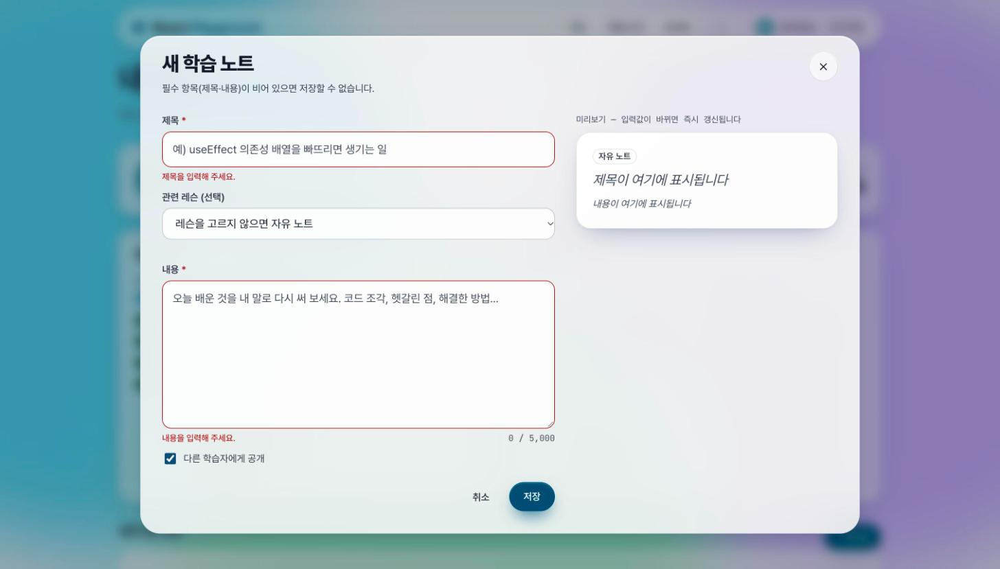
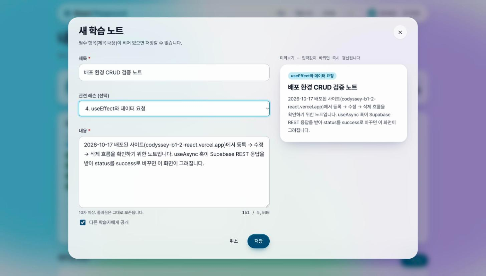
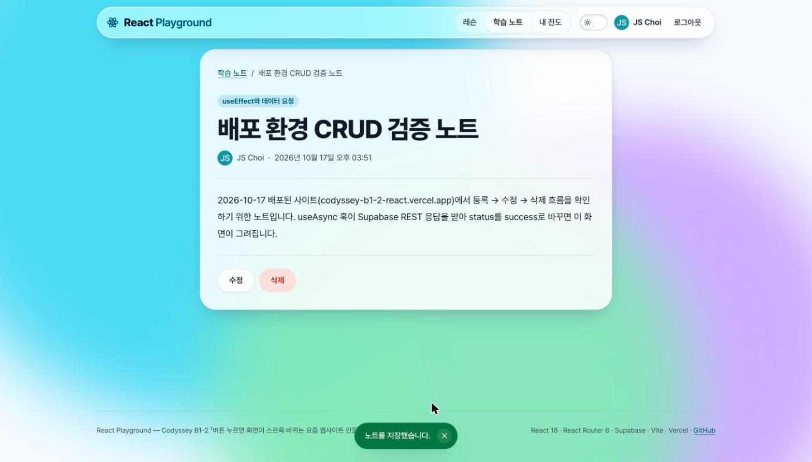
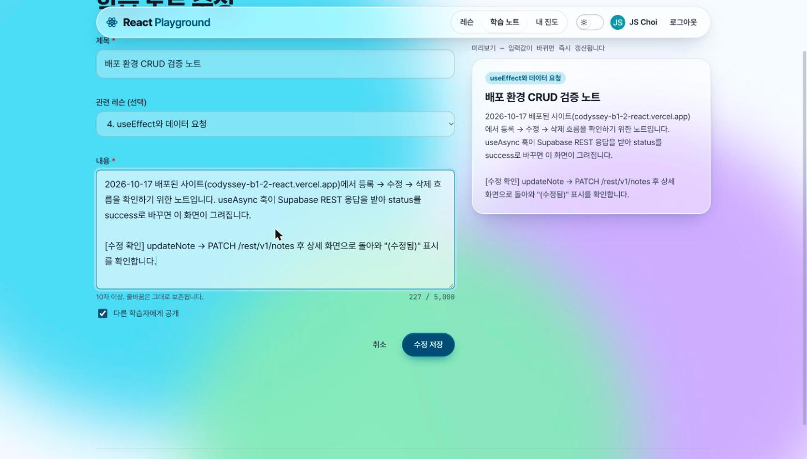
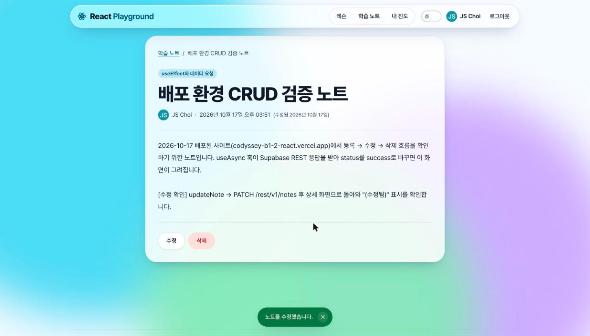
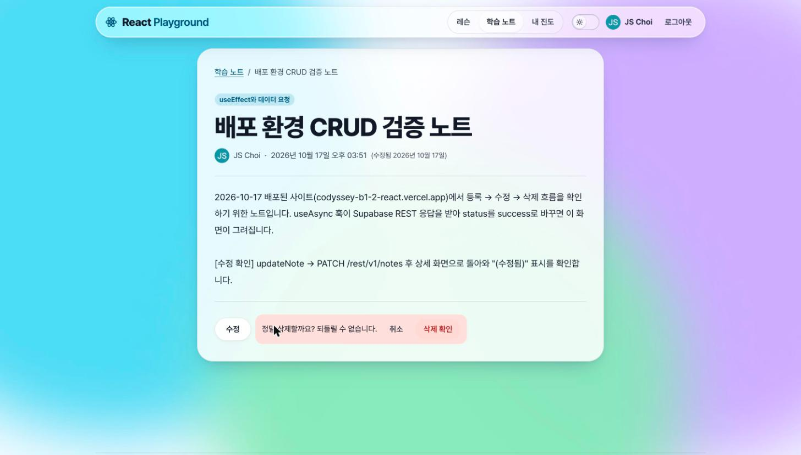
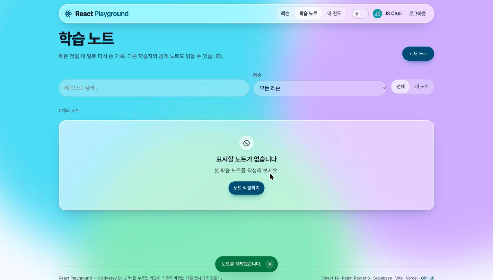

# 배포 환경 CRUD 검증 기록

배포된 사이트에서 노트 **등록 → 수정 → 삭제**를 실제로 수행하고, 화면·브라우저 요청 로그·서버 조회 세 가지로 교차 확인한 기록입니다.

| 항목 | 값 |
| --- | --- |
| 검증 일시 | 2026-10-17 15:51–15:52 KST (UTC 06:51–06:52) |
| 대상 | https://codyssey-b1-2-react.vercel.app (Vercel production, 커밋 `6bbc32c` 빌드) |
| 계정 | Google 로그인한 소유자 계정 (표시 이름 JS Choi) |
| 브라우저 | Chrome, 뷰포트 1456×829, 라이트 모드 |
| 검증 노트 id | `a2618fa5-95f7-46bd-91c8-63aa577b4db5` (검증 후 삭제 완료) |

**방법.** 화면은 조작 직후 캡처했습니다. 브라우저 요청 로그는 페이지에 `window.fetch` 래퍼를 심어 `/rest/v1/` 요청의 시각·메서드·경로·상태 코드를 모았습니다(래퍼는 등록 직후에 심었으므로 등록 요청은 서버 `created_at`으로 확인). 서버 반영 여부는 별도 터미널에서 anon 키로 Supabase REST를 조회(`curl`)해 대조했습니다. 비밀 값은 이 문서에 없습니다.

## 1. 단계별 화면

| # | 조작 | 기대 결과 | 실제 결과 | 캡처 |
| --- | --- | --- | --- | --- |
| 1 | 프로필의 "+ 새 노트" → 팝업에서 빈 폼 저장 | 제목·내용 아래 에러, 요청 없음 | "제목을 입력해 주세요." "내용을 입력해 주세요." 표시, 저장 안 됨 |  |
| 2 | 제목·내용 입력, 레슨 "4. useEffect와 데이터 요청" 선택 | 오른쪽 미리보기 즉시 갱신, 글자 수 카운터 | 미리보기에 배지·제목·본문 반영, `151 / 5,000` |  |
| 3 | 저장 | POST 성공 → `/notes/:id` 상세로 이동 + Toast | 상세 화면, "노트를 저장했습니다" Toast, 서버 `created_at` 06:51:21 |  |
| 4 | "수정" → 기존 값 로드 → 문단 추가 | 폼에 기존 값, 미리보기 갱신 | GET 200으로 로드, `227 / 5,000` |  |
| 5 | "수정 저장" | PATCH 성공 → 상세 복귀, "(수정됨)" + Toast | "(수정됨 2026년 10월 17일)", "노트를 수정했습니다" Toast |  |
| 6 | "삭제" | 인라인 확인 UI | "정말 삭제할까요? 되돌릴 수 없습니다. 취소 / 삭제 확인" |  |
| 7 | "삭제 확인" | DELETE 성공 → `/notes` 이동, 목록에서 제거 + Toast | "0개의 노트" 빈 상태, "노트를 삭제했습니다" Toast |  |

## 2. 브라우저 요청 로그 (Supabase REST)

```
2026-10-17T06:51:21Z  POST   /rest/v1/notes  -> 201   (등록. 서버 created_at 06:51:21.494로 확인)
2026-10-17T06:51:47Z  GET    /rest/v1/notes  -> 200   (수정 페이지 진입, useNote(id) 로드)
2026-10-17T06:52:00Z  PATCH  /rest/v1/notes  -> 200   (수정 저장, updateNote)
2026-10-17T06:52:00Z  GET    /rest/v1/notes  -> 200   (상세로 navigate → useNote 재조회, PATCH 79ms 뒤)
2026-10-17T06:52:25Z  DELETE /rest/v1/notes  -> 204   (삭제, deleteNote)
2026-10-17T06:52:25Z  GET    /rest/v1/notes  -> 200   (목록으로 navigate → useNotes 재조회, DELETE 65ms 뒤)
```

쿼리 문자열(`?id=eq.…&select=…`)은 생략했습니다. 모든 요청은 `Authorization: Bearer <사용자 JWT>`로 나가며, RLS가 `auth.uid() = user_id`를 검사합니다.

## 3. 서버 교차 확인 (anon 키 REST 조회)

조회 명령 형태 (값은 `.env`에서 읽음):

```bash
curl "$VITE_SUPABASE_URL/rest/v1/notes?id=eq.<id>&select=id,title,created_at,updated_at" \
  -H "apikey: $VITE_SUPABASE_ANON_KEY" -H "Authorization: Bearer $VITE_SUPABASE_ANON_KEY"
```

| 시점 | 응답 |
| --- | --- |
| 등록 직후 | `[{"id":"a2618fa5-…","title":"배포 환경 CRUD 검증 노트","lesson_slug":"use-effect","is_public":true,"created_at":"2026-10-17T06:51:21.494848+00:00","updated_at":"2026-10-17T06:51:21.494848+00:00"}]` HTTP 200 |
| 수정 직후 | `updated_at` = `2026-10-17T06:52:00.705+00:00` (브라우저 PATCH 시각과 밀리초까지 일치), `content`에 추가 문단 포함 |
| 삭제 직후 | `[]` HTTP 200 — 행 없음 |

anon 키로 읽힌 이유는 노트가 `is_public = true`이기 때문입니다. 같은 키로 insert/update/delete를 보내면 `auth.uid()`가 없어 RLS가 거부합니다(평가 설명서 §6 시나리오 25).

## 4. 이 기록이 보여 주는 상태 갱신 전략

- **노트 CRUD는 재조회(refetch) 방식.** 등록·수정·삭제 성공 뒤 `navigate()`로 경로를 바꾸면 `useNote(id)` / `useNotes(params)`의 fetcher 참조가 바뀌어 `useAsync`의 `useEffect`가 다시 요청합니다. 위 로그에서 PATCH·DELETE 직후 GET이 따라오는 것이 그 증거입니다. 서버를 단일 진실로 두어 낙관적 업데이트의 롤백 로직을 노트에는 두지 않았습니다.
- **레슨 완료 토글만 낙관적 업데이트.** `useLessonProgress`는 클릭 즉시 배지를 바꾸고, 실패하면 이전 값으로 되돌립니다. 진도 표시는 즉시 반응이 중요하고 실패 비용이 낮기 때문입니다.

## 5. 실패 케이스 — 권한이 없으면 서버가 거부한다

같은 anon 키로 **로그인 없이** 쓰기를 시도한 실제 응답입니다 (2026-10-17 16:05 KST).

| 시도 | 응답 |
| --- | --- |
| `POST /rest/v1/notes` (제목·내용 포함) | HTTP 401 `{"code":"42501","message":"new row violates row-level security policy for table \"notes\""}` |
| `GET /rest/v1/profiles?select=id,email` | HTTP 401 `{"code":"42501","message":"permission denied for table profiles"}` — 이메일 컬럼은 anon/authenticated에 select 권한이 없음 |

앱에서는 이런 응답이 `toUserMessage()`를 거쳐 "권한이 없습니다. 로그인 상태를 확인해 주세요."로 바뀌어 `ErrorState`(조회) 또는 폼 아래 `submitError`(제출)로 표시됩니다. UI의 `ProtectedRoute`는 편의 장치이고, 권한의 최종 결정은 DB의 RLS입니다.
